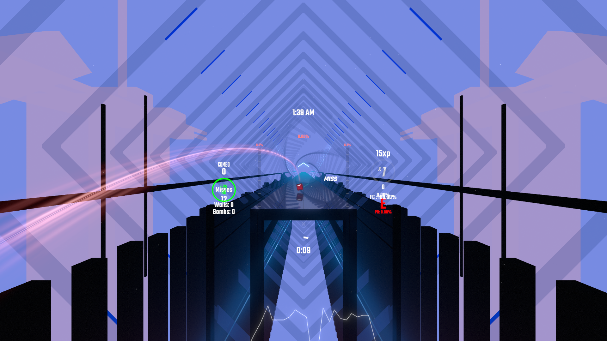
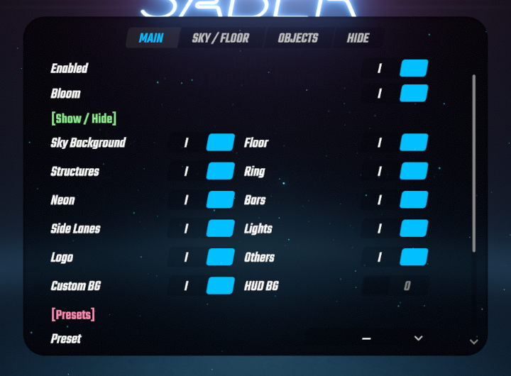
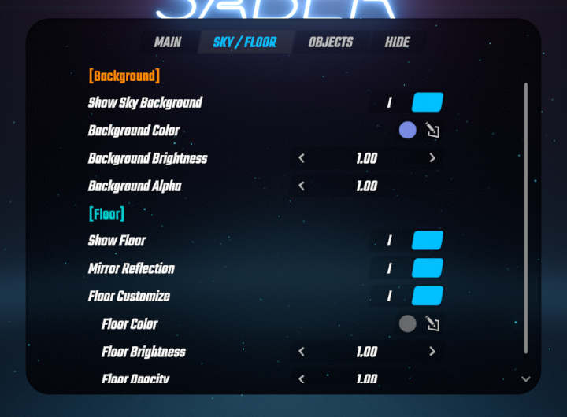
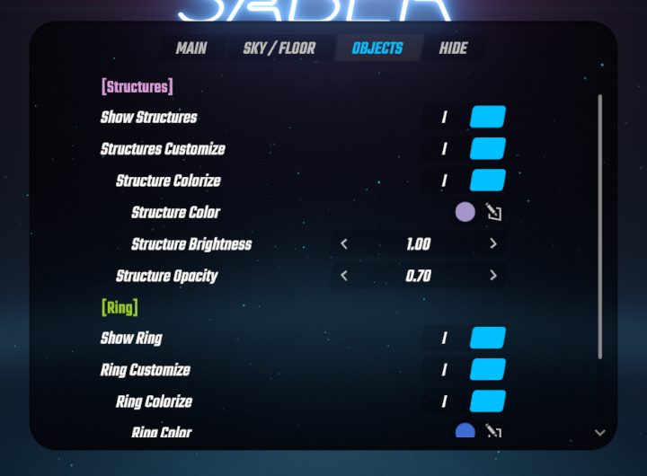
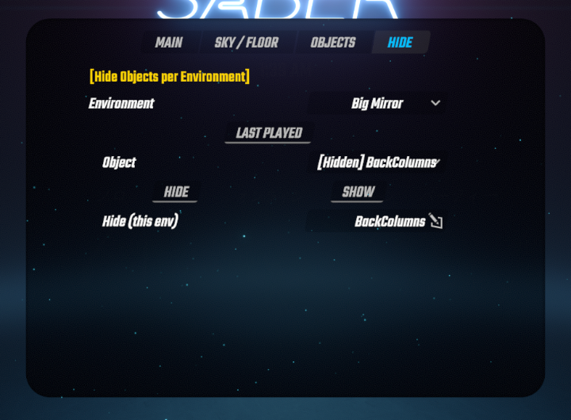

# SkyLight
既存Environment（環境）の背景や床、構造物の色を変更したり非表示にするMODです。  
明るさなど見やすいように調整が可能です。  

名称は「BeatSaberに空を取り戻そう」というコンセプトで作り始めたことに由来でしています。  
加齢で視力が落ち、暗い背景でノーツが滲んだりブレて見えないので自分用に作ったものですが  
AIの進化によりブルーム設定が背景や床に効いてしまう問題とリングの描画遅延の問題が解消したので公開します。  

|  |  |
|---|---|
|  |  |

## 対応版
- Beat Saber 1.40.8 / 1.44.1（1つの DLL が両方で動きます）。
- 1.44.1 では、manifest の `gameVersion` が 1.40.8 のため、BSIPA が「developed for game version 1.40.8」という警告を出します。読み込み自体はされます。

## 必須 MOD
BSIPA、BeatSaberMarkupLanguage（BSML）、SiraUtil。

## 設定画面
ソロ選曲画面の **MODS** タブ → **SkyLight**。設定はその場で保存され、次の曲から効きます。

| タブ | 内容 |
|---|---|
| Main | MOD の ON/OFF、BloomのON/OFF 空・床・構造物・リング・ネオン・バー・ライト・ロゴなど表示/非表示を設定 プリセット機能 デフォルト設定にリセット |
| Sky / Floor | 空の色・明るさ・不透明度、床の色・明るさ・不透明度、床の反射(Mirror Reflection)を設定 |
| Objects | 構造物とリングの色・明るさ・不透明度を設定 |
| Hide | 環境ごとに、非表示にするオブジェクトを設定【カスタム設定】 |

| Main | Sky / Floor |
|---|---|
|  |  |

| Objects | Hide |
|---|---|
|  |  |

## 保存先
`<Beat Saber のフォルダ>\UserData\` の下です。
- `SkyLight.json`：設定。
- `SkyLight\<名前>.json`：プリセット（設定画面の Presets で保存・読込・削除）。MOD の ON/OFF とログの設定は、プリセットには含まれません。
- `SkyLight\Environments\HideObjects.json`：環境ごとの非表示リストと、見つかったオブジェクトの候補。壊れて読めないときは `.broken` に退避して作り直します。

## 既知の限界
- カスタムプラットフォームの地形は、塗り直せません。
- バー（Spectrogram）の色は変えられません（表示/非表示だけ）。
- ネオン・レーザーは Bloom で光るため、色塗りに向きません（表示/非表示だけ）。
- 全画面の Bloom は画面のアルファで光る量が決まるため、空・床・リングはアルファ 0 で描いています。

## ライセンス
MIT（`LICENSE`）。
